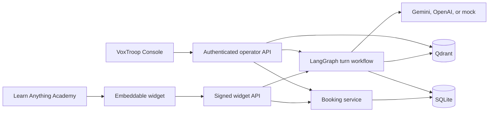
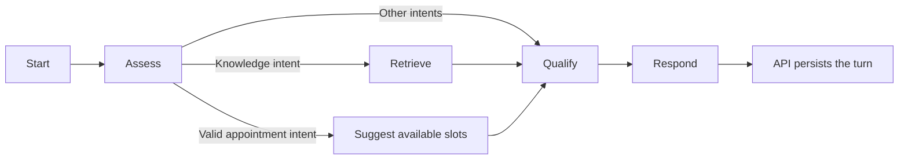

# VoxTroop AI Sales Agent


VoxTroop is a multi-tenant AI sales assistant that turns product enquiries into grounded recommendations and confirmed appointments. Learn Anything Academy is the demo client in this repository. A visitor can explain a career goal, compare relevant courses, open verified course links, and book academic counselling from the same widget. Staff can review conversations, evidence, leads, and bookings in the VoxTroop Console.

## Why this project exists

Product catalogues and sales workflows often live in separate tools. VoxTroop connects them through a reusable widget, tenant-specific knowledge, and a backend that handles the business rules. LangGraph routes conversation turns. FastAPI validates the operations that read and change business records.

## What it implements

- **Agentic conversation routing** for recommendations, enquiries, qualifications, language preferences, and appointment requests. The graph uses configurable consultation fields, recent history, and a stored customer profile.
- **Grounded recommendations** backed by Qdrant similarity search and verified catalogue entries. The model ranks relevant products, and the backend resolves returned product IDs to registered links.
- **Multi-tenant isolation** across admin access, widget sessions, SQLite records, and vector search filters. The Academy and UrbanHomes demo tenants exercise the same backend.
- **Explicit booking** with server-provided slots, contact review, duplicate confirmation handling, and an optional staff approval policy. The model may request availability, while the booking API controls writes.
- **Operator tools** for knowledge upload, conversation inspection, profile-based lead scoring, and appointment review. The public widget and Console render structured replies with separate administrative trace data.
- **Mock and live providers** with deterministic offline tests, optional Gemini-to-OpenAI fallback, English and Hindi counselling, and OpenAI-backed transcription and playback when configured.

## System architecture



A FastAPI process owns LangGraph, local Qdrant, and SQLite. Chat state is reconstructed from the tenant configuration, conversation profile, and recent transcript on each turn. Qdrant stores vectorized knowledge and provenance. SQLite stores the business records and enforces tenant-scoped uniqueness.

### Agent workflow and grounding



Uploaded text and text PDFs are split into overlapping chunks, embedded, and written to the tenant's vector index. Retrieval searches the appropriate tenant with a context-aware query. The model sees evidence and available catalogue metadata. It produces a concise reply and product IDs, and the server resolves those IDs to verified URLs. Turn Inspection retains the route, provider, model, and matched sources. The widget receives customer-facing reply fields.

### Appointment workflow

An explicit customer request retrieves real availability. The customer chooses an offered time, reviews the timezone and contact details, and clicks confirm. The server rechecks the slot, applies the tenant policy, and commits the appointment and customer association. A repeated confirmation for the same booked slot returns the original reference. Appointment and lead records appear in the Console.

## Technology stack

| Layer | Implementation |
| --- | --- |
| API and validation | Python, FastAPI, Pydantic, Uvicorn |
| Agent orchestration | LangGraph and LangChain provider adapters |
| Models and embeddings | Gemini and OpenAI adapters, deterministic mock mode |
| Retrieval and persistence | Local Qdrant, SQLite, SQLAlchemy |
| Client and Console | React, TypeScript, Vite, and a JavaScript iframe SDK |
| Verification | Pytest, FastAPI TestClient, TypeScript and Vite builds |

## Repository layout

```text
.
├── voxtroop/
│   ├── backend/       FastAPI, LangGraph, retrieval, CRM, booking and voice
│   ├── frontend/      Operator Console and embed test page
│   ├── sdk/           Browser loader and customer chat frame
│   └── tests/         Backend regression suite
├── src/               Academy demo client and canonical course catalogue
├── public/            Demo client assets
├── scripts/           Academy knowledge and catalogue sync
└── docs/              Architecture, APIs, database, booking, and setup
```

## Run locally

Use Python 3.12 and Node.js 24. Start with mock mode to run the services and tests without model credentials. [Follow the complete installation guide](docs/SETUP.md).

| Service | Local address |
| --- | --- |
| FastAPI | [Health](http://127.0.0.1:8000/health) · [OpenAPI UI](http://127.0.0.1:8000/docs) |
| Operator Console | [localhost:5173](http://localhost:5173/) |
| Academy demo client | [localhost:5174](http://localhost:5174/) |

The Academy sync generates knowledge documents and product URLs from the same course data used by the website. For an example embed using the Academy tenant, enable the host origin in Business Settings and add the public SDK.

```html
<script src="http://127.0.0.1:8000/widget.js" data-business="edunext" defer></script>
```

## Demo walkthrough

1. Open the Academy and choose **Talk to AI Counsellor**. In configured live mode, say “I study data science and know Python, LangChain, and Excel. I want to become an AI Full Stack Engineer.”
2. Open a recommended course from the chat. Its details open in a new tab and the conversation remains open.
3. Ask for an appointment. Choose a server-provided time, review the contact details, and confirm using a fictional contact in a test workspace.
4. Match the receipt reference in Console **Appointments** and inspect the conversation and lead. Use **Agent Playground → Turn Inspection** to explain what evidence the agent used.

The browser workflow above has been exercised with a live provider against isolated data. Mock mode is intended for local smoke tests and deterministic backend checks. See the [reproducible demo steps](docs/SETUP.md#demonstrate-the-workflow). The repository ships a runnable demo and architecture diagrams.

## Technical documentation

- [System architecture](docs/ARCHITECTURE.md)
- [LangGraph agent workflow](docs/AGENT_WORKFLOW.md)
- [API reference](docs/API_REFERENCE.md)
- [Database schema and tenant isolation](docs/DATABASE_SCHEMA.md)
- [Appointment booking](docs/BOOKING_FLOW.md)
- [Setup and environment settings](docs/SETUP.md)

## Current limits and next steps

The local topology uses a single backend process. Qdrant local storage is process-locked, SQLite serializes writes, and widget throttling is per process. Scaling to multiple instances would require shared persistence and rate limiting. Model ranking and localization vary by provider. Equivalent fallback retrieval requires indexing the same knowledge for that provider. Voice is turn-based and depends on configured OpenAI audio models. The Academy catalogue is demonstration content.
