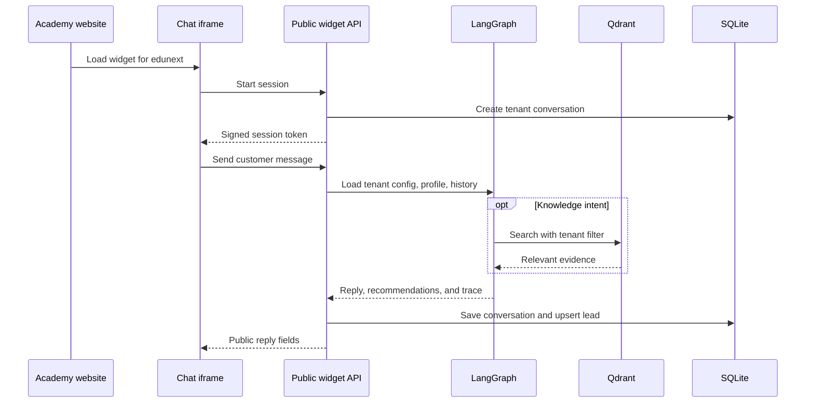

# System architecture

VoxTroop is a modular monolith. FastAPI owns the application lifespan, resource ownership, tenant configuration, and persistence. The Console uses authenticated administration endpoints. A client website loads a small JavaScript SDK that embeds an isolated first-party frame from the VoxTroop backend.

## Trust boundaries

- The embedding page gets a public business ID and SDK URL. The iframe response uses a tenant-specific CSP frame allowlist.
- The widget uses a signed token scoped to its conversation and tenant. Admin routes use a server-configured bearer token or a scoped tenant credential.
- Provider keys and vector access stay behind FastAPI. Tenant ownership is enforced on database lookups and Qdrant searches. Model output is input to deterministic routing and validation.
- The Console and widget share the conversation service. Internal retrieval sources and graph trace are available in the Console. Customer responses use a smaller payload.

## Lifecycle and deployment

FastAPI creates database and vector resources at startup and closes them at shutdown. Gemini and OpenAI embedding indexes are separate. Each backend instance should own its local storage directory. The checked-in Vite proxy targets the local backend for Console development. A hosted deployment needs HTTPS, an appropriate admin API routing configuration, verified public product URLs, and exact widget embedding origins.

The Academy source is the demo client. Its catalogue synchronization is an operator action that uses the existing business configuration and knowledge endpoints.
