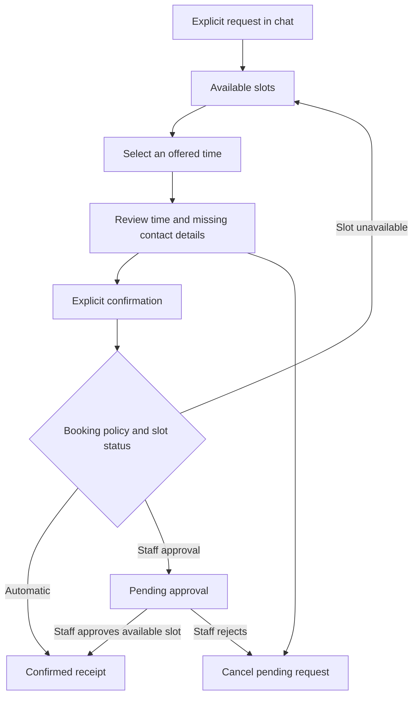

# Appointment booking

The public route in [widget.py](../voxtroop/backend/widget.py) validates its signed conversation session before invoking [booking.py](../voxtroop/backend/booking.py). Suggested times are future weekday half-hour slots in the business timezone, found over the next 14 days. The public proposal must match a server-offered time. Confirmation must match the pending slot, include valid name and email from the request or profile, and pass a fresh availability check.

A write transaction and the database's unique business-and-slot constraint protect against races. Conflicts can return replacement times. A retry of a previously booked slot returns the same reference for that conversation. Cancellation clears a pending request. The API returns `pending_approval` until staff approve when that policy is enabled. Only confirmed appointments contribute to confirmed appointment metrics.

The widget displays localized review controls and uses the tenant timezone for the receipt. Staff see the confirmed reference, conversation, and linked lead in the Console.
