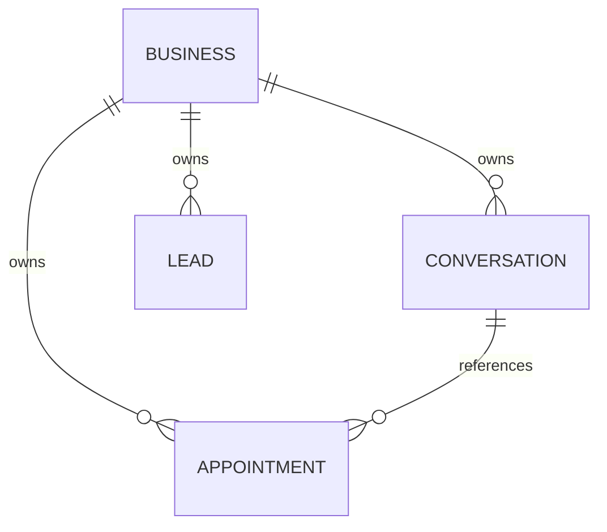

# Database schema and tenant isolation

The table definitions are in [db.py](../voxtroop/backend/db.py). The application enforces one confirmed public booking per conversation. The schema enforces unique slots by business.

| SQLite table | Key fields and constraints |
| --- | --- |
| businesses | ID, configuration JSON |
| conversations | ID, business FK, transcript, profile, intelligence, pending slot, approval flag, updated timestamp |
| leads | ID, business FK, email, profile, score, reasons, status. Unique business and email. |
| appointments | ID, business FK, conversation FK, normalized slot. Unique business and slot. |

Booking contact and lead association metadata are stored in the conversation profile. The confirmed record references the conversation, and the Console's records response enriches its appointment row using that metadata. SQLite foreign keys and WAL are enabled. Appointment writes are serialized with an immediate transaction.

Qdrant uses a `knowledge` collection per configured local vector store, with cosine similarity. A chunk has a deterministic ID and a payload containing business, document hash, source filename, chunk number, and text. Chunk size is 900 with overlap 120. Search returns up to four candidates with minimum scores of 0.35 in live embeddings and 0.15 in mock embeddings. Scores indicate similarity. Search, listing, and deletion are scoped to the business. Content hashes deduplicate equivalent text within a tenant.
