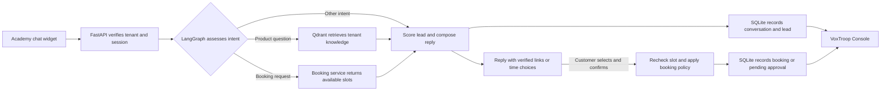

# VoxTroop AI Sales Agent Project Report

[Project README](../README.md) · [Run the demo](SETUP.md#demonstrate-the-workflow) · [Architecture](ARCHITECTURE.md) · [API reference](API_REFERENCE.md)

## Project at a glance

VoxTroop helps businesses turn enquiries into grounded recommendations, qualified leads, and confirmed appointments. **Learn Anything Academy** is the demo client. A visitor can describe a career goal, open a recommended course, and book counselling from the same chat widget. Staff can inspect the conversation, retrieved evidence, and booking in the VoxTroop Console.

## From enquiry to appointment

How recommendations stay grounded

LangGraph uses the customer's context to select a workflow. Qdrant retrieval is scoped to the tenant. The backend validates returned catalogue IDs and supplies their stored URLs. Staff can inspect document names, chunk identifiers, and similarity scores in Turn Inspection.

[Explore the agent workflow](AGENT_WORKFLOW.md)

How booking avoids accidental or duplicate writes

The customer must pick a server-provided time and explicitly confirm it. The API rechecks availability and applies the tenant's booking policy. SQLite enforces a unique business-and-slot pair. A repeated confirmation of the same booking returns the existing reference.

[Explore the booking flow](BOOKING_FLOW.md)

## Verification

**10 backend tests passed** after a clean Python install, and both frontend builds passed. An isolated live-provider demo also verified that the Academy widget produced a confirmed booking whose reference, conversation, and lead could be found in the Console.

**Current scope:** Single-process local deployment. Production scaling would require shared storage and rate limiting. Provider behavior depends on the configured model and indexed knowledge.
