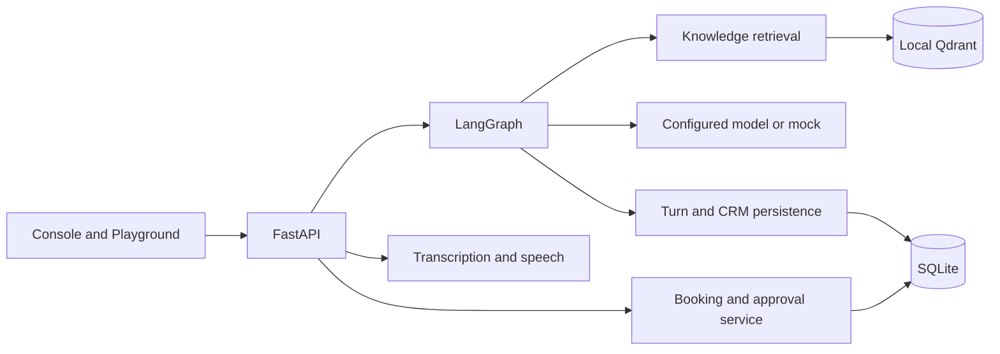
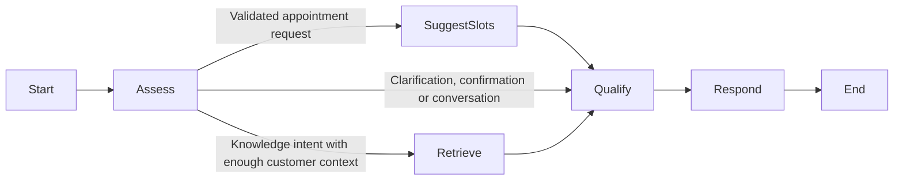
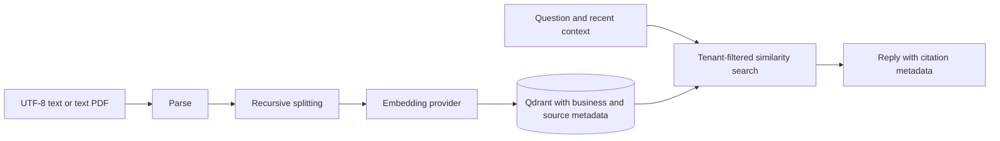
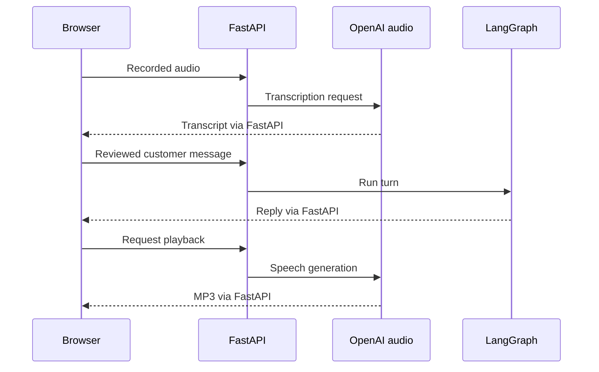
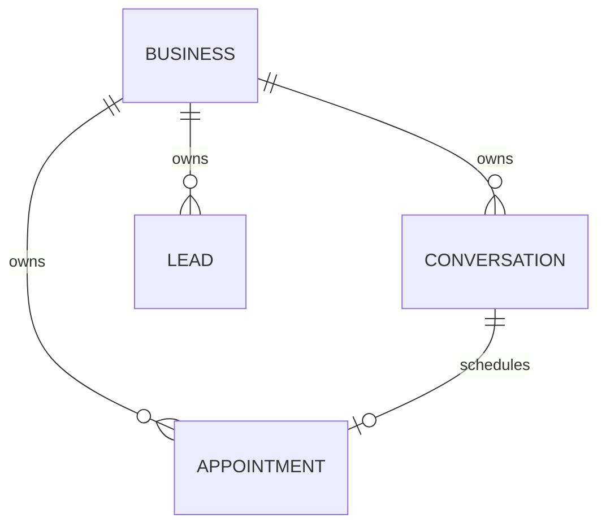
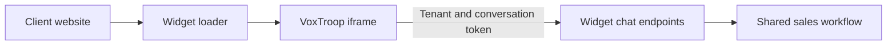
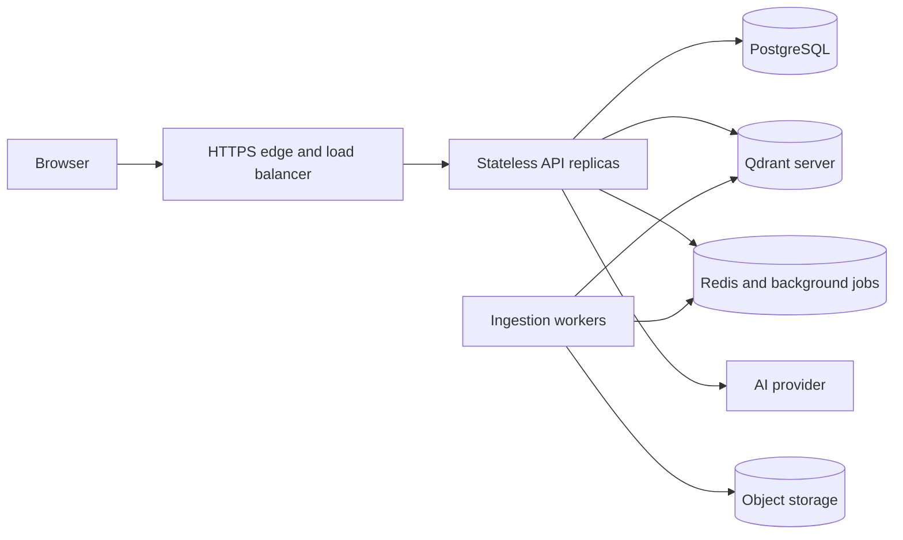

# VoxTroop architecture

One FastAPI process owns the local database and Qdrant client. The console calls FastAPI through Vite's development proxy. The browser never receives model credentials.

## Agent turns

FastAPI supplies recent turns, the current message, tenant configuration and accumulated profile. The assessment distinguishes purchase, pricing, recommendation, qualification, objection, language preference, and appointment actions. It returns sentiment, a summary, customer-stated facts and a standalone retrieval query. The business configuration defines consultation fields. The profile persists those facts and explicit language preferences. Incomplete recommendations ask up to two questions. The deterministic qualification node records weights. The backend stores the full turn and upserts by tenant and normalized email. The booking branch reads available slots. In the Playground and widget, customers choose a slot and explicitly confirm it. Only the appointment API can create an appointment, after checking timezone, business hours, slot uniqueness and policy. SQLite serializes booking writes. The graph is reconstructed from persisted conversation state on each request.

## Retrieval

Text content hashes deduplicate equivalent input per tenant. Gemini and OpenAI fallback have separate indexes. Retrieval records matching chunk scores using the existing 0.35 live and 0.15 mock thresholds. Similarity measures relevance and can return evidence that does not answer a question. The response prompt requires support for every business claim. The vector payload stores the file name, chunk number, content hash and business ID. Deletion applies both business and document filters. Mock and live Qdrant directories are separate.

## Voice turn

## Data model

## Client website

## Proposed production topology

